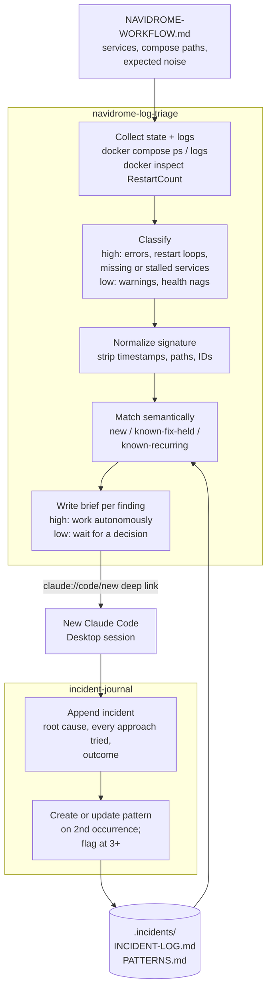

# claude-ops-skills

Two [Claude skills](https://docs.claude.com/en/docs/agents-and-tools/agent-skills/overview) that
turn container-log checks for a self-hosted Docker media stack into a repeatable incident process:

| Skill | What it does |
| --- | --- |
| [`navidrome-log-triage`](skills/navidrome-log-triage/SKILL.md) | Scans Docker logs and container state for every service in the pipeline, classifies findings as high or low priority, matches them against the incident journal, and opens one Claude Code Desktop session per finding with a pre-written brief. |
| [`incident-journal`](skills/incident-journal/SKILL.md) | Records the outcome of an investigation in an append-only `INCIDENT-LOG.md` and keeps `PATTERNS.md` current, so the next scan recognizes a recurring problem and knows which fixes already failed. |

They were written for a Navidrome / Picard / Audiobookshelf stack on Windows with PowerShell 7,
but the process (scan, classify, check history, hand off, record) carries over to any Docker
Compose project with a document that lists its services.

## How they fit together

## Design choices worth noting

- **Priority is about whether the pipeline is doing its job, not log level.** A failing health
  check on a container that is still processing media is low priority; a warning that coincides
  with a stalled scan is high.
- **Duplicates collapse to signatures.** Volatile parts (timestamps, paths, IDs, ports, hashes)
  are stripped so 200 identical lines become one finding with a count and time range.
- **History is matched by mechanism, not string equality.** `PATTERNS.md` describes each problem
  in prose, including the different ways it has been worded, so a reworded error from a new
  version still matches.
- **Failed approaches are first-class data.** The journal records everything tried and whether
  it held. A brief for a recurring problem tells the next session which fixes not to repeat.
- **Recurrence escalates.** A low-priority signature seen three or more times is treated as high.
- **Low-priority sessions don't make changes.** They present an assessment and wait for a
  decision. Recording an outcome and changing the system are kept separate.
- **No silent fallbacks.** If Docker is unavailable the scan stops instead of guessing log paths.

## Install

1. Replace every `<project-root>` in both `SKILL.md` files with the folder that holds your
   pipeline document (for example `D:\Projects\navidrome`).
2. Install the skills one of these ways:
   - **Claude Code:** copy each folder under `skills/` to `~/.claude/skills/` (personal) or
     `<repo>/.claude/skills/` (project).
   - **Claude apps:** zip each skill folder and upload it as a custom skill in the app's
     skills settings.
3. Create `NAVIDROME-WORKFLOW.md` (or rename it in the triage skill) listing the services,
   container names, compose file paths, and any services that are expected to be noisy or
   stopped.

`incident-journal` creates `.incidents\INCIDENT-LOG.md` and `.incidents\PATTERNS.md` on first use.

## Requirements

- Windows with PowerShell 7 (`pwsh`) and Docker Desktop or Docker Engine.
- Claude Desktop with Claude Code, for the `claude://code/new` deep link that opens one session
  per finding. Desktop asks you to confirm the folder each time and prefills the prompt without
  sending it.

## License

MIT. See [LICENSE](LICENSE).
